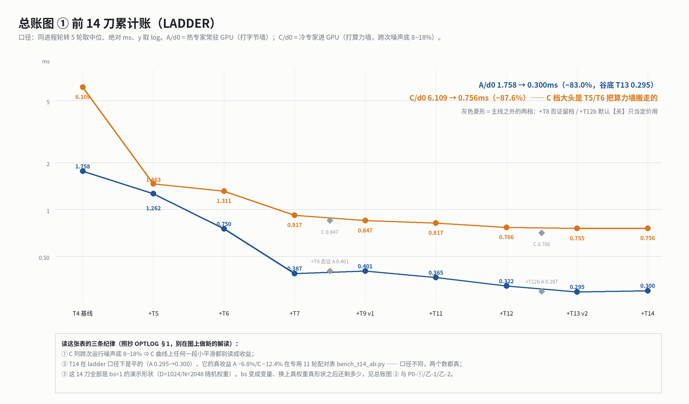
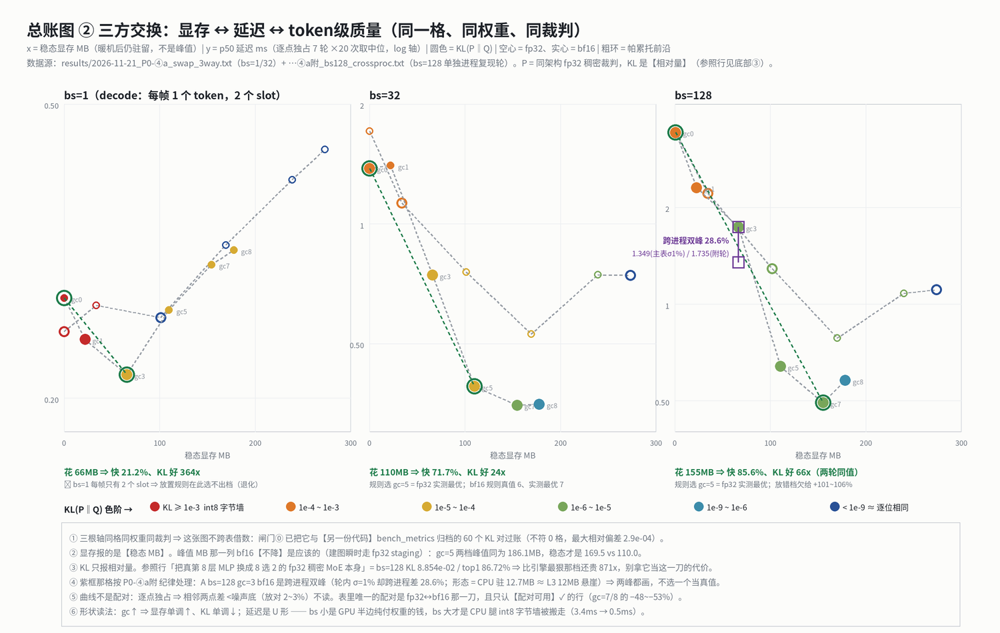

# Unit-price expert placement for heterogeneous MoE — measurements, price tags and one negative result on a 12-thread desktop

> **English front page.** The authoritative text is Chinese (`README.md`, `writeups/paper_short.md`).
> This page and `writeups/paper_short_en.md` are translations of those two, held to the same gates:
> **every number below is copied verbatim from the Chinese text**, and every 8-hex code in backticks is the
> `md5` prefix of an archived verdict table in `results/` (all of them run by hand, full text committed,
> machine state in the header line). If a translation and the Chinese disagree, **the Chinese wins** — please open an issue.

**System under test.** On a CPU+GPU machine: hot experts resident on GPU, cold experts resident on CPU as **int8 weights, fetched by routing**, the two legs overlapped, so per-frame latency ≈ `max(CPU leg, GPU leg) + fixed serial host overhead`.
Model = SmolLM-135M **real weights**, `D=576, N=1536`, the 8 experts of one MLP layer used as 8 experts, `top_k=2`
(real routing is naturally skewed **433x** hottest:coldest). Machine = i5-10400 (6C/12T, DDR4 **measured 42GB/s**,
12MB L3, no AVX-VNNI) + RTX3060 (skinny-GEMM **measured 250GB/s**).

> 🚨 **This repository contains no "adaptive / dynamic placement works" claim.** Every citable gain comes from **one-shot placement at start-up**.
> 🚨 We **do not compare numbers with any published MoE inference system** (not run ⇒ not in a table). KTransformers-class systems are read as **motivation** only.
> 🚨 All constants are **machine-specific** (42GB/s, 250GB/s, 12MB L3, 6C/12T, a desktop steals cores). **What transfers is the method and the conclusion, not the numbers.**




---

## Positioning in three sentences

1. **What it is**: a *measurement study* of expert placement for CPU+GPU MoE inference on one ordinary desktop, which delivers a
   **unit-price criterion `u_e`** (0 free parameters, one 8-float offline table) whose chosen resident set **is** the
   measured-KL-minimal one in **3/3 corpus segments**, plus a cost map of the two CPU walls.
2. **What it is not**: it is not a claim that adaptive placement pays. Across **four pre-registered decision trees**,
   dynamic placement was **never validly evaluated once** — all four trees died at the *ruler pre-check* — and the paper
   gives the quantitative reason **why this ruler fails on this machine**.
3. **Where the boundary is**: the constants do not travel (they are this box's), the scale does not travel
   (single node, single GPU, `E=8`/top-2, 135M shape), and no number here is a comparison with a published system.

---

## 0. Three-minute version

| # | What this leg rests on | The hardest single number |
|---|---|---|
| ① **The model itself holds** | 乙-1 / P0-② (`delay=3ms` kills the CPU leg; every cut aimed at it goes flat) | **Overlap pays in 16/16 cells**: +8.5%~+67.6% (gemm A column rises monotonically with bs) `5bb8a840` |
| ② **The cost structure holds (two walls)** | T8/T14/乙-2 + P0-①②③④a | CPU byte wall 49us/expert (gemm 2MB) ~63us (swiglu 2.53MB) at 42GB/s, compute wall 7us/slot at 288GMAC/s, **crossover ≈5 slots/expert**; GPU skinny **250GB/s** `ebf87c3b` |
| ③ **The gain is decomposable and attributable** | LADDER 14 cuts + 乙-1/乙-2/乙-2b/乙-2c + P0-①②③④a | A/d0 **1.758 → 0.300ms (−82.9%)**, C/d0 **6.109 → 0.756ms (−87.6%)**; the −60~−76% seen under decode all comes from host-side serialisation |

**Speedups you may quote** (🚨 **a ratio must always travel with its bs**): swiglu `bs=128` **5.47x vs pure-CPU / 1.51x vs pure-GPU**,
`bs=32` 2.61x / 1.40x; gemm `bs=128` 4.18x / 1.25x. 🚨 At `bs=4` it is only 1.11~1.63x, and at `bs=1` **pure CPU wins**;
the sentence outside models like to write — "CPU latency 3ms ⇒ 3.5x" — measures **1.0x** (`5bb8a840`).

**The two rules actually delivered**

- **Unit-price criterion `u_e`** (default): within-segment Spearman **+1.00 in all three segments**, 23 cross-segment cells
  **0.92~1.11**, the resident set it picks is the **measured-KL-minimal one in 3/3 segments**, and the coverage/heat criteria are
  **1.60x more expensive** on the drift segment (`2e7f1cb2`, `3ce6836d`). Across domains you need **one 8-float price table per domain**
  (`kappa_e` cross-segment Spearman is only +0.16).
- **Traffic-sparse batching (removes the dense tax)**: a zero-traffic expert costs **35.8→3.6us (fp32, ÷9.9) / 20.6→1.8us (bf16, ÷11.4)**
  per frame ⇒ at `bs=1` the best cell is **0.184ms** < the same build on **pure CPU 0.279ms** = **−34.1%** (`64436f8a`).
  🚨 It lands **only at `bs=1`**; at `bs=128` the traffic path loses badly, **+238.3%** (`25746271`).

**The negative result (four pre-registered trees, four unsettled bookings).** One changed variable per round; the criterion values and the rig code are never touched.

| Round | The single changed variable | Landing | The only red item |
|---|---|---|---|
| r1 `c299b2b9` | Build the rig (7 arms × 3 blocks × 24 frames of synthetic drift) | **K0** | Empty control `底_pair 6.91% > TARGET=5%` |
| r3 `96ecadf1` | Change only the star rule (★ → ★2) | **M0, 2nd time** | oracle ★2 blocks = []; `底_pair 4.18%` passed but **`底_序 16.00%`** ⇒ threshold 32.0% |
| r4 `48499173` | Change only the estimator (per-block p50 → **block sum**) | **M0″, 3rd time** | `底_pair 8.41%` (bimodal 11/21 → **0/21**, `底_序` 16.00% → 6.94%, both worked, still red) |
| r5 `1f69a7cb` | Change only the replication unit (pass → **process**, NP=5) + randomise arm build order | **M0‴, 4th time** | per-process `底_pair` `[5.81/5.03/7.42/5.05/4.73]%`, median **5.05%**, short by **0.05pp** |

Qualitative conclusion: this box carries a **per-instance one-off offset** (`σ_inst≈1.6%`, worst-cell per-process range `4.73~7.42%`)
that **does not respond to the number of passes, to the estimator, to arm build order, or to the number of processes**
⇒ **arm-vs-arm differences of ≲5~7% are not resolvable on this machine.**
The escape hatch "buy one more layer of replication" was **killed offline**: `k=3` buys the pre-check at `P(green)≈98%`, but the
question still cannot be decided (the `±1σ` on `T` is still **3.9x** the spacing between decision points; deciding needs `k≈47`
= 329 instances = physically impossible).

---

## 1. Three lines that may not be crossed

1. **A ratio travels with its bs.** Heterogeneity does not help under decode (`bs=1`); pure CPU wins there.
2. **Quality is reported as a relative quantity only.** The referee is a same-architecture 8-of-2 **fp32 dense MoE**, not the original
   model; "replacing a dense FFN with an MoE at all" already costs **668x / 871x / 1585x** (three bs settings), so within this reference
   frame KL differences between engine cells can only be read as "between gc values / between dtypes". The corpus is an
   **out-of-domain** readme patchwork and there is **no held-out ppl** ⇒ absolute ppl is meaningless.
3. **If the pre-check fails, the question may not be read.** Criterion, thresholds and landing are all **written down before the run**
   and evaluated by code; the pre-check (is the ruler fit) is separate from the question (the science). Four unsettled bookings are the price list of that discipline.

---

## 2. Not done (registered, not dressed up)

| Item | Status | Why |
|---|---|---|
| Reproduce on a second machine (B3) | **Not done** (resource-constrained ⇒ parked, **not disproved**) | The only way to overturn "≲5~7% is unresolvable here"; no second physical instance to hand. All four layers of replication buyable on one machine (passes / estimator / arm order / processes) were already spent in r1~r5. Candidate-machine probe `probe_b3_machine.sh` is committed |
| Same-instance switch (B6) | Left open | It would be a **sixth change to the ruler**, which conflicts with "criteria written down before the run" |
| What natural drift is worth on real text | **Unmeasured** (not a negative result) | One **zero-cost pre-scan** only (`scan_drift.py`: reads gate histograms, builds no arm, times nothing ⇒ not part of the record); no work order was issued on it ⇒ **no sign, positive or negative, is claimed** |
| held-out ppl / downstream tasks | Not done | Corpus is out-of-domain patchwork. Swapping corpora is one knob (`CORPUS=`) but it **is a new measurement**. And note: a new corpus **does not buy an absolute scale** — the ceiling is the referee, not the corpus |
| Multi-GPU / expert parallelism / 64+ experts / int4 / VNNI / large-bs tuning | Frozen | All in the disproof list, or gated behind P0 |
| Turn the synthetic drift up and re-judge | **Not done** (constructive reason ⇒ not an oversight) | The pre-check measures an **arm that never fires**, so it is independent of stimulus amplitude; "can it see a large effect" was already answered by positive control C1 passing the star in **3/3 blocks** (`3efbe364`/`96ecadf1`) ⇒ derivation in `writeups/paper_short.md` §6.5 |

---

## 3. Reproduce (hard constraint: **this machine, this interpreter**)

```bash
cd <repo root>
PY=/home/adomlans/miniconda3/envs/dl_lab/bin/python   # 🚨 this interpreter, not base (its 3.14 profiler is broken)
ROUNDS=3 ./run_all.sh red            # red lines: do the gates still bite
ROUNDS=25 ./run_all.sh dynpair       # ruler calibration (empty control + both orders)
(date; ROUNDS=48 NP=5 ./run_all.sh drifttrackN) 2>&1 | tee /tmp/p1i_drifttrack_r6.txt   # ≈32~40min
/home/adomlans/miniconda3/envs/dl_lab/bin/python writeups/make_ledger.py   # reconciles before drawing; refuses if numbers disagree
```

Commit thresholds this project set for itself: header `loadavg < 0.8`, `ROUNDS ≥ 7`, per-round σ%.
Verdict tables are run by the author and committed in full (machine state in the header); **anything run by a model is labelled "not part of the record"**.

---

## 4. Reading order

| Path | What it is | Language |
|---|---|---|
| `README.en.md` | this front page | EN |
| `writeups/paper_short_en.md` | **English short paper** (self-contained: abstract + 8 sections + limitations + reproduction) | EN |
| `README.md` | Chinese front page (authoritative) | ZH |
| `writeups/paper_short.md` | Chinese short paper (authoritative) | ZH |
| `writeups/README.md` | deliverable index: §4 lists all 42 archived tables with their freshness credentials, §4.1 accounts for the 10 that never made the text, §7 limitations (honest version) | ZH |
| `writeups/blog1_measurement.md` / `writeups/blog2_two_walls_placement.md` / `writeups/blog3_real_shape_bf16.md` | measurement discipline / the two walls and the price derivation / real shape + bf16 + decode | ZH |
| `OPTLOG.md` | the lab log itself (4000+ lines: pre-registration, landing, bookings, invalidations) | ZH |
| `results/` | **42 verdict tables + 5 five-process dumps from r5** | raw |

🚨 **Translation status, stated plainly**: the short paper and this front page are translated; the three blogs, the `writeups/README.md`
index and `OPTLOG.md` are **not** (they are ~10x the length and are working logs, not claims). Nothing in them was rewritten while translating.

**Term map** (for reading the Chinese tables): 空对照 = empty/never-firing control arm · `底_pair` = pair floor · `底_序` = order floor ·
挂账 = booked unsettled (no verdict) · 预设判决树 = pre-registered decision tree · 前置 = pre-check · 落点 = landing ·
价签 = price tag · 稠密税 = dense tax · 双峰 = bimodality · 每实例一次性偏移 = per-instance one-off offset · 追认 = ratify.

---

## 5. Licence and attribution

The code tree derives from `labmlai/annotated_deep_learning_paper_implementations` (MIT, see `LICENSE`); all of this project's work
is inside the `glu_variants` subtree. See `ATTRIBUTION.md`, which also records that **`HANDOFF.md` (the Chinese working handoff file)
is deliberately not published**.

**Author**: 曹志瑄 (Zhixuan Cao) · Jiangsu Police Institute · Cybersecurity and Law Enforcement · sophomore · GitHub [@adomlans](https://github.com/adomlans)
— no e-mail address in the public repository (scraping); please use Issues.
