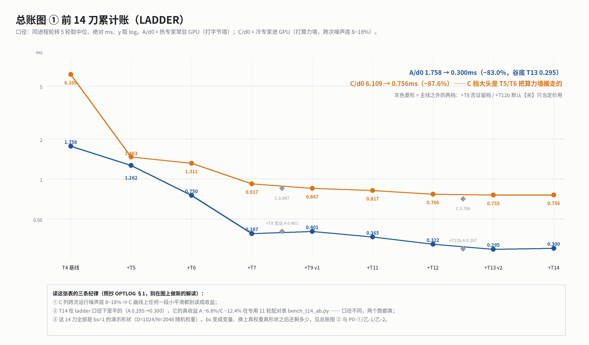
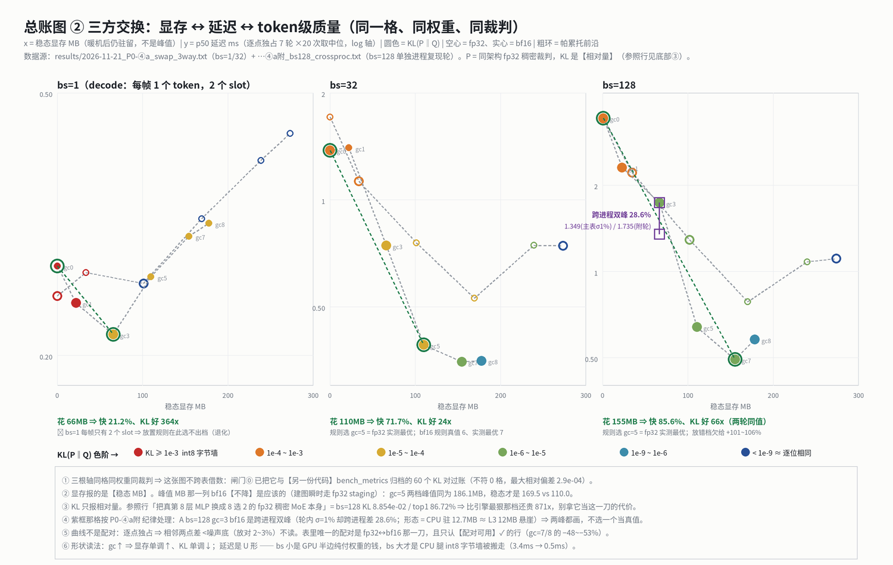

# 异构 MoE 的单价判据放置：一台 12 核台式机上的度量、价签与一个负结果

在 CPU+GPU 异构机器上跑 MoE：热专家常驻 GPU、冷专家以 **int8 权重常驻 CPU 并按路由取用**、两条腿重叠，
每帧延迟 ≈ `max(CPU 腿, GPU 腿) + 固定串行主机开销`。本仓库交付三样东西：

1. **一个可复用的放置判据**：单价 `u_e`（0 个自由参数、一张 8-float 的离线表），3/3 个语料段上选出的常驻集**就是实测 KL 最小的那个**；
2. **一张代价地图**：CPU 侧两堵墙（字节墙 / 算力墙）+ GPU 侧按权重字节付钱 + 可吃掉的「稠密税」；
3. **一个负结果（本仓库最主要的一条；scope = 本仓库的四次尝试）**：**动态放置（跟着流量漂移搬专家）在本仓库四棵跑前写死的判决树里没有一次被有效考核过** ——
   四棵**跑前写死**的预设判决树全部死在「尺子前置」，并给出「这把尺在本机为什么不合格」的定量证明。

> 🚨 **本仓库不含「自适应 / 动态放置有效」这一类主张。** 目前可引用的收益全部来自**开局一次性放置**。
> 🚨 本仓库**不与任何已发布的 MoE 推理系统比数字**（没跑过 = 不进表）；KTransformers 一类只当**动机**读。
> 🚨 所有常数**本机专属**（42GB/s、250GB/s、12MB L3、6C/12T、桌面会抢核）。**可迁移的是测法与结论，不是数字。**




---

## 0. 三分钟版本

**被测对象**：SmolLM-135M 真权重（`D=576, N=1536`）取 8 层 MLP 当 8 个专家、`top_k=2`（真路由天然偏斜 **433x**）；
机器 = i5-10400（6C/12T、DDR4 实测 **42GB/s**、L3 12MB、无 AVX-VNNI）+ RTX3060（skinny GEMM 实测 **250GB/s**）。

| # | 这条腿被谁证明 | 最硬的一个数 |
|---|---|---|
| ① **模型本身成立** | 乙-1 / P0-②（`delay=3ms` 把 CPU 腿按死后，打 CPU 腿的刀全部变平） | **重叠的价格 16/16 格为正**：+8.5%~+67.6%（gemm A 档随 bs 单调涨）`5bb8a840` |
| ② **代价结构成立（两堵墙）** | T8/T14/乙-2 + P0-②③④a | CPU 字节墙 49us/专家(gemm 2MB)~63us(swiglu 2.53MB)@42GB/s、算力墙 7us/slot@288GMAC/s、**交叉点≈5 slot/专家**；GPU skinny **250GB/s** `ebf87c3b` |
| ③ **收益可分解、可归因** | LADDER 14 刀 + 乙-1/乙-2/乙-2b/乙-2c + P0-①②③④a | A/d0 **1.758 → 0.300ms（−83.0%）**、C/d0 **6.109 → 0.756ms（−87.6%）**；decode 下的 −60~−76% 全来自主机侧串行 |

**对外可引用的倍数**（🚨**倍数必须连着 bs 一起报**）：swiglu `bs=128` **vs 纯CPU 5.47x / vs 纯GPU 1.51x**、
`bs=32` 2.61x / 1.40x；gemm `bs=128` 4.18x / 1.25x。🚨`bs=4` 只有 1.11~1.63x、`bs=1` 是**纯 CPU 赢**；
外部模型爱写的那句「CPU 延迟 3ms 时 3.5x 加速」实测是 **1.0x**（`5bb8a840`）。

**已交付的两个规则**：
- **单价判据 `u_e`**（默认档）：段内 Spearman **三段全 +1.00**、跨段 23 格 0.92~1.11、选出的常驻集 **3/3 段 = 实测 KL 最小**、
  覆盖/热度判据在 drift 段**贵 1.60x**（`2e7f1cb2`、`3ce6836d`）；跨域要**按域各备一份 8-float 价表**（`kappa_e` 段间 Spearman 仅 +0.16）。
- **traffic-sparse 分批（修掉稠密税）**：零流量专家每帧 **35.8→3.6us(fp32, ÷9.9) / 20.6→1.8us(bf16, ÷11.4)** ⇒
  `bs=1` 最优 **0.184ms** < 同份纯 CPU `0.279ms` = **−34.1%**（`64436f8a`）。🚨分批只在 `bs=1` 落地，`bs=128` 上大亏 **+238.3%**（`25746271`）。

**负结果（四棵预设判决树，四次挂账）**：唯一自变量逐轮换，判据数值/装置代码一字不改。

| 轮 | 唯一自变量 | 落点 | 唯一红项 |
|---|---|---|---|
| r1 `c299b2b9` | 建装置（7 臂 × 3 块 × 24 帧人造漂移） | **K0** | 空对照 `底_pair 6.91% > TARGET=5%` |
| r3 `96ecadf1` | 只换星标口径（★→★2） | **M0 第二次** | oracle ★2 块 = []；`底_pair 4.18%` 过了但 **`底_序 16.00%`** ⇒ 门槛 32.0% |
| r4 `48499173` | 只换估计量（每块 p50 → **块和**） | **M0″ 第三次** | `底_pair 8.41%`（双峰 11/21→**0/21**、`底_序` 16.00%→6.94% 全起效，仍红） |
| r5 `1f69a7cb` | 只换复制单位（发 → **进程**，NP=5）+ 建臂顺序随机化 | **M0‴ 第四次** | `底_pair` 逐进程 `[5.81/5.03/7.42/5.05/4.73]%`、中位 **5.05%**，差 **0.05pp** |

定性结论：本机存在**每实例一次性偏移**（`σ_inst≈1.6%`、逐进程最坏格极差 `4.73~7.42%`），
它**不吃发数、不吃估计量、不吃建臂顺序、也不吃进程数** ⇒ **本机对 ≲5~7% 的臂间差不可分辨**。
「再买一层重复就能判」这条退路已**离线核算判死**：`k=3` 能把前置买到 `P(绿)≈98%`，但落点判不动
（问句 `T` 的 `±1σ` 仍是判定点间距的 **3.9x**，判动需 `k≈47` = 329 实例 = 物理不可能）。

---

## 1. 目录地图

| 路径 | 是什么 | 建议读者 |
|---|---|---|
| `writeups/paper_short.md` | **小论文（全文自洽版）**：摘要 + 8 节 + 局限 + 复现，每个数字括号标归档 md5 前 8 | 先读这个 |
| `writeups/README.md` | 交付物索引：主张三条腿、被测对象、两张总账图、**§4 判决表索引（42 张归档逐张列保鲜凭据）**、**§4.1 没进正文的 10 张逐张记归属**、§7 局限（诚实版） | 查数字出处 |
| `writeups/blog1_measurement.md` | 测量方法论：预设判决树、同进程轮转配对、空对照/正对照/上限锚、闸门 ⓪~⑨、尺子史 | 想知道「怎么保证没骗自己」 |
| `writeups/blog2_two_walls_placement.md` | 两堵墙 + 单价判据 + 迁移价签的推导 | 想知道「账是怎么算出来的」 |
| `writeups/blog3_real_shape_bf16.md` | 真形状 / bf16 / decode 那一段 | 想看落地口径 |
| `writeups/make_ledger.py` | **两张图的生成脚本，自带对账**：`verify()` 直接解析 `results/` 与 OPTLOG 的 LADDER 表，**对不上就 `SystemExit` 拒绝出图** | 想验证「图上没有一个数是手填的第二次」 |
| `results/` | **42 张判决表全文 + 5 份 r5 五进程 dump**（合计 47 个文件）。每张的头行是机器状态（date / MHz / loadavg）= 保鲜凭据 | 证据链 |
| `OPTLOG.md` | 实验日志原件（4000+ 行，含每轮的**事前预测**、落点、挂账、作废记录） | 想看全过程 |
| `hetero_moe_int8.py` + `avx_gemv_int8.cpp` | 引擎本体：CPU 侧 int8/AVX2 GEMV + GPU 侧常驻专家 + worker 重叠 + CUDA Graph | 想看代码 |
| `dyn_placement.py`、`bench_dyn*.py`、`bench_drifttrack.py`、`combine_drifttrack.py` | 动态放置 + 漂移语料装置 + **跑前写死的 K 树组合器** | 负结果的装置 |
| `check_redlines.py` | 红线（含「静态档零迁移」「放置无关性」「slot↔专家映射连查」等，抓到过 4 个真 bug） | 想知道闸门长什么样 |
| `run_all.sh` | 唯一入口：打印机器状态 + 钉死解释器 + 短名→装置 | 复现 |
| `scan_drift.py`、`probe_b3_machine.sh` | 两个**零判决成本**探针（不建臂、不计时、不参与任何判决树 ⇒ 输出**不进记录**，只用于路线裁决） | 想看「跑之前怎么先算值不值得跑」 |

---

## 2. 阅读顺序

- **5 分钟**：本文件 → 两张图 → `writeups/paper_short.md` 的摘要 + §6。
- **30 分钟**：`paper_short.md` 整篇（§5 迁移价签三刀 + §6 负结果是重点）→ `writeups/README.md` §7 局限。
- **2 小时**：`blog1_measurement.md`（方法论）→ `blog2_two_walls_placement.md`（账）→ 随便挑 `results/` 里一张表，
  用 `writeups/README.md` §4 的保鲜凭据核对它是不是同一份。

---

## 3. 复现（硬约束：**只有这一台机器、这一个解释器**）

```bash
cd <本仓库根目录>
PY=/home/adomlans/miniconda3/envs/dl_lab/bin/python   # 🚨 必须这一个解释器（base 的 3.14 profiler 是坏的）
python -c "import torch;print(torch.__version__, torch.version.cuda)"   # 本机 = 2.15.0+cu132 / RTX3060 sm_86

ROUNDS=3 ./run_all.sh red            # 红线：闸门还咬得动吗
ROUNDS=3 ./run_all.sh swapcost       # 迁移价签三刀的装置
ROUNDS=25 ./run_all.sh dynpair       # 尺子标定（空对照 + 正反序）
(date; ROUNDS=48 NP=5 ./run_all.sh drifttrackN) 2>&1 | tee /tmp/p1i_drifttrack_r6.txt   # ≈32~40min
/home/adomlans/miniconda3/envs/dl_lab/bin/python writeups/make_ledger.py   # 出图前先对账，对不上直接退出
```

依赖：`torch`（CUDA）、`pillow`（出图）、`safetensors` + 权重 `HuggingFaceTB/SmolLM-135M`（≈270MB，
联网自动下；离线就从 `~/.cache/huggingface/hub/models--HuggingFaceTB--SmolLM-135M` 拷）；AVX2 扩展由
`torch.utils.cpp_extension` 现场编译（需 `g++` + `ninja`，首次 import ≈10s）。

**入库门槛（本项目自己给自己立的规矩）**：头行 `loadavg < 0.8`、`ROUNDS ≥ 7`、逐轮 σ%；
判决表由人自跑并贴全文（机器状态在头行），模型自跑一律标「**不进记录**」。

---

## 4. 三条不许越过的口径

1. **倍数必连 bs 报**：异质性在 decode（`bs=1`）下不给力，`bs=1` 是纯 CPU 赢。
2. **质量只报相对量**：裁判 = 同架构 8 选 2 的 **fp32 稠密 MoE**（不是原模型）；「把稠密 FFN 换成 MoE 本身」
   就贵 **668x / 871x / 1585x**（三个 bs 档）⇒ 在这个参照系下引擎各档之间的 KL 只能读「gc 之间 / dtype 之间」。
   语料是**域外** readme 拼贴、**没有 held-out ppl** ⇒ 绝对 ppl 无意义。
3. **前置不过 ⇒ 问句不许读**：判据、门槛、落点全部**跑前写死**、由代码求值；前置（尺子合不合格）与问句
   （科学问题）分开，前置不过落点只能写「挂账」。四次挂账就是这条纪律的价目表。

### 4.1 口径对照表（**只填有 / 无**，不填任何数字）

> 这张表回答「你跟别人是什么关系」，但**一个数字都不比** ⇒ 不违反上一条「不与已发布系统比数字」。
> 🚨右列**只写本仓库自己可核对的事实**：本机没有网络 ⇒ **不凭记忆盘点别人的系统有什么**——
> 用同一把尺子量自己：**没核对过的不进表**。要对照，请拿各家官方文档对着左列自己勾。

| 口径轴 | 本仓库 | 凭据（`results/` md5 前 8） |
|---|---|---|
| 真权重 + 真形状（SmolLM 形状 `D=576/N=1536`、8 专家 top-2、真路由偏斜 433x） | ✅ 有 | `6a34d45c` |
| 冷专家 int8 常驻 CPU + AVX2 kernel + 与 GPU 腿重叠 | ✅ 有 | `ebf87c3b`, `5bb8a840` |
| 放置判据 = **单价 `u_e`**（0 自由参数、一张 8-float 离线表） | ✅ 有 | `2e7f1cb2`, `3ce6836d` |
| 显存**峰值 / 稳态**两列分开报 | ✅ 有 | `a1dabef9` |
| 跑前写死的**预设判决树**（前置与问句分离、落点由代码求值） | ✅ 有 | `c299b2b9`…`1f69a7cb` 四棵 |
| 空对照（从不开火的同配置臂）+ 正对照 + oracle 上限锚 | ✅ 有 | `d9d54f5b`, `3efbe364` |
| 噪声底定量 + 「买重复层能不能判动」的离线核算 | ✅ 有 | `1f69a7cb` |
| 每张表头行留 `date / MHz / loadavg` 并设入库门槛 | ✅ 有 | 全部 42 张归档 |
| **动态放置的有效性主张** | 🚨 **无** | 四次挂账 ⇒ 只报「没被有效考核过一次」 |
| 多卡 / EP / 64+ 专家 / held-out ppl / 与已发布系统对打 | ❌ **无** | 见 §5 |


---

## 5. 没做的（登记，不粉饰）

| 项 | 状态 | 为什么没做 |
|---|---|---|
| **换机器复现（B3）** | **未做**（资源约束 ⇒ 搁置，**不是判死**）| 唯一能翻死因「本机 ≲5~7% 不可分辨」的买法，但**手边没有第二台物理实例**（同一台机器上能买的四层重复——发数 / 估计量 / 建臂顺序 / 进程数——已在 r1~r5 全部买光）。预备探针 `probe_b3_machine.sh` 已入库 |
| **同实例开关（B6）** | 挂着 | 等于**第六次动尺子**，与「跑前写死判据」冲突 |
| **真实文本上的自然漂移值多少钱** | **未计量项**（不是负结果） | 只做过一次**零成本预检**（`scan_drift.py`：只读 gate 直方图、不建臂、不计时 ⇒ 不进记录、不算任何兑现），据此**未发工单** ⇒ 本文对「真实文本上动态放置值多少」**不给正负任何结论** |
| **held-out ppl / 下游任务** | 未做 | 语料是域外拼贴；换语料是 `CORPUS=/path/to/wt2.txt` 一个旋钮的事，但**属新测量**（结项冻结 ⇒ 要用户点头才开轮）。🚨且要说清：**换语料买不到绝对刻度** —— 绝对 ppl 的天花板是「裁判 = 同架构稠密 MoE、不是真模型」那条局限，换语料只把「域外」换成「域内 held-out」，**参照系不变** |
| **多卡 / 专家并行（EP）/ 64+ 专家 / int4 / VNNI / 大 bs 调优** | 冻结 | 全部在否证清单里，或有 P0 兜底才做 |
| **把人造漂移幅度加大再判一次** | **不做**（构造性理由 ⇒ 不是遗漏） | 前置 `底_pair` 量的是**从不开火的空对照臂** ⇒ 与刺激幅度无关，加大幅度买不到前置绿；「大效应判得动吗」已由正对照 C1 **3/3 块过星标**答过（`3efbe364`/`96ecadf1`）⇒ 推导见 `writeups/paper_short.md` §6.5 |

---

## 6. 许可与署名

代码树派生自 `labmlai/annotated_deep_learning_paper_implementations`（MIT，见 `LICENSE`）；
本项目的全部工作集中在 `glu_variants` 子树（`hetero_moe_int8.py`、`avx_gemv_int8.cpp`、35 个 `bench_*.py`、
`dyn_placement.py`、`combine_drifttrack.py`、`check_redlines.py`、两个探针、`writeups/`、`results/`、`OPTLOG.md`）。
详见 `ATTRIBUTION.md`（含发布前自查清单）。

**作者**：曹志瑄（江苏警官学院 · 网络安全与执法 · 大二在读）· GitHub [@adomlans](https://github.com/adomlans)
　—— 公开仓库不写邮箱（防爬），联系走 Issues；邮箱在简历上（简历是一对一文件）。
